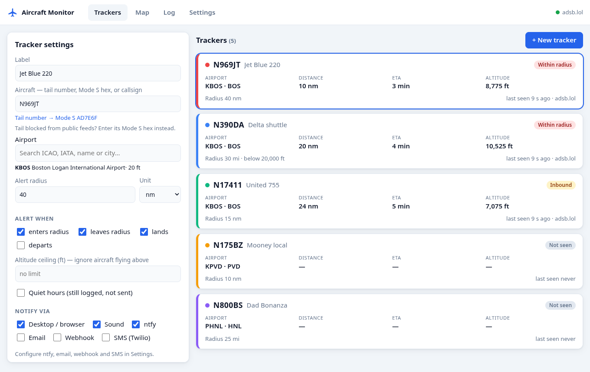
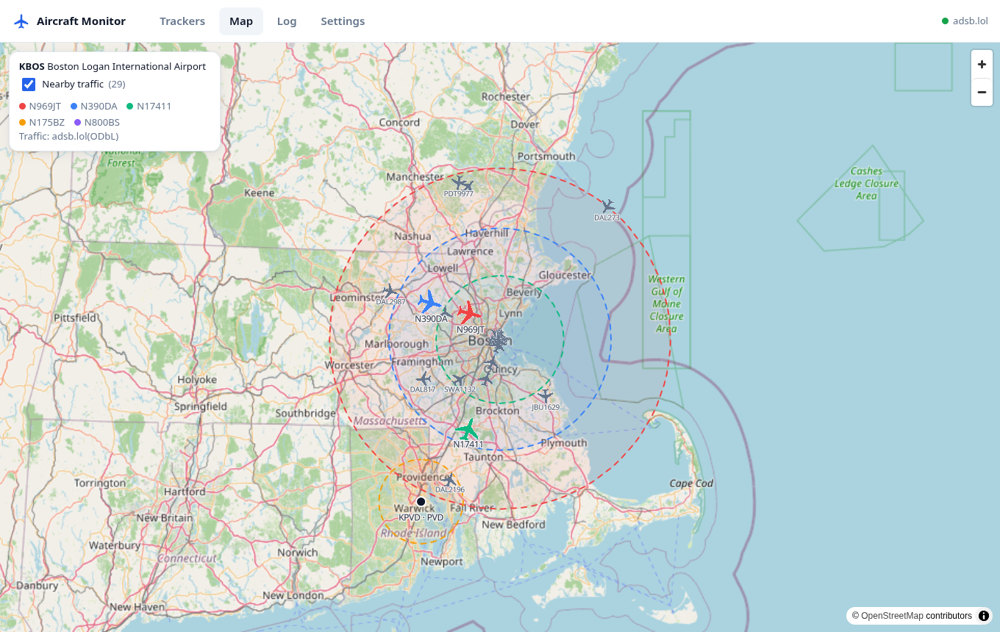
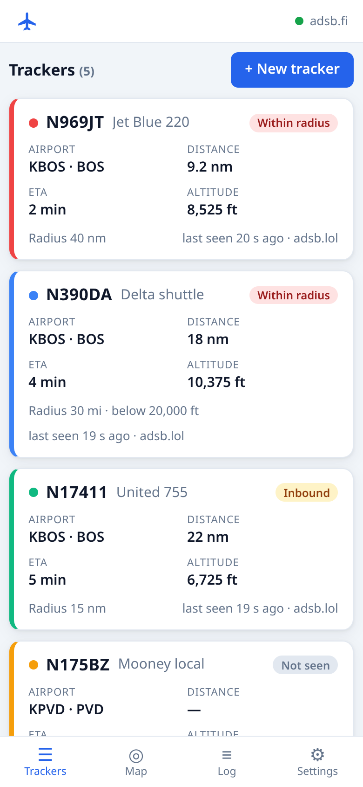
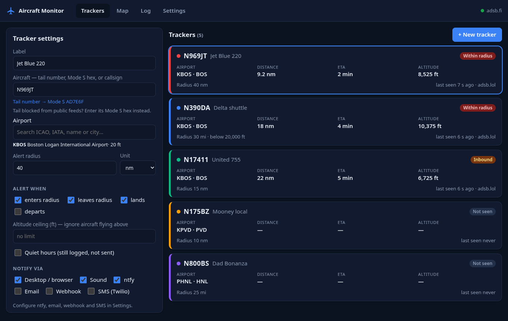
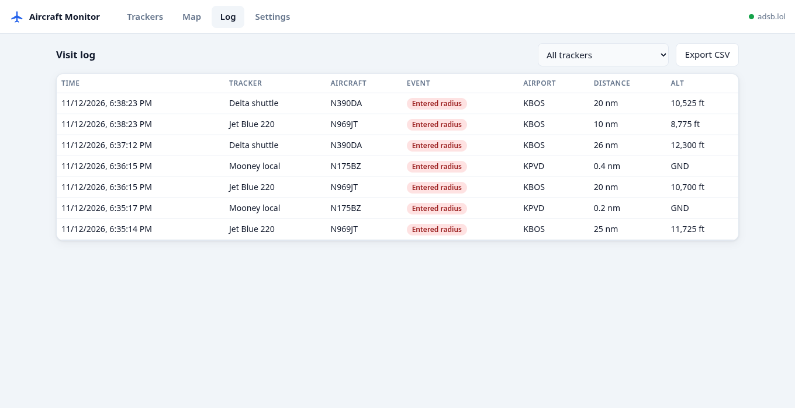
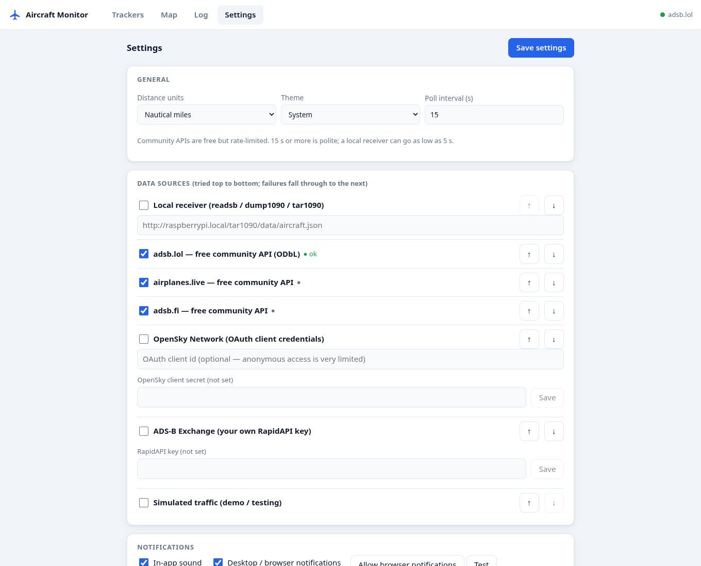

# Ramp Radar

Get alerted when a specific aircraft gets close to an airport — and watch it on a live map.

One Rust core, one web UI, two ways to run it:

* **Desktop app** (Windows, macOS, Linux) — Tauri 2 shell, native notifications, secrets in the OS keychain.
* **Headless server** (Raspberry Pi, Linux box, Docker) — open it in any browser on your LAN, phone included.

It is the successor to a single-aircraft Tkinter tool: many aircraft at once, many notification channels,
a map, history, and pluggable data sources with automatic failover.

| Trackers | Map (live traffic near KBOS) |
|---|---|
|  |  |

| Phone | Dark | Log | Settings |
|---|---|---|---|
|  |  |  |  |

*(Screenshots were taken from the running server against live adsb.lol / adsb.fi data.)*

## Download

Installers and server binaries are on the [latest GitHub release](https://github.com/Ethan-Poag/ramp-radar/releases/latest).

Pick the file for your OS:

* **Windows:** the `.msi` or the `-setup.exe`. Builds are unsigned, so Windows SmartScreen may warn you — click **More info**, then **Run anyway**.
* **macOS:** the `.dmg` (Apple silicon or Intel). Builds are unsigned — right-click the app and choose **Open** (or run `xattr -dr com.apple.quarantine "/Applications/Ramp Radar.app"`).
* **Linux desktop:** the `.AppImage` or `.deb` (and `.rpm` if one is attached).
* **Raspberry Pi / Linux server:** `ramp-radar-server-linux-arm64.tar.gz` or `ramp-radar-server-linux-x86_64.tar.gz` — see the server install steps below.

Repo: [Ethan-Poag/ramp-radar](https://github.com/Ethan-Poag/ramp-radar).

## Features

* **Trackers** — one watched aircraft (tail number, Mode S hex, or callsign) + target airport + alert radius
  (nm / mi / km) + options: alert on *enter / exit / landing / departure*, altitude ceiling, quiet hours
  (events are still logged), per-tracker notification channels, colour and label, enabled switch.
* **Cards** with status (*inbound, within radius, on ground, outbound, not seen*), distance, ETA, altitude, last seen.
  Click a card → its settings open on the left. Phone-friendly: panes stack, bottom tab bar.
* **Map** — MapLibre GL on OpenStreetMap tiles: airport, radius rings, tracked aircraft with heading and trails,
  optional all-nearby-traffic layer.
* **Visit log** — arrivals / departures / radius crossings per tracker, **CSV export**.
* **Data sources with failover** (order is yours): local readsb/dump1090/tar1090, adsb.lol, airplanes.live,
  adsb.fi, OpenSky (OAuth client credentials), ADS-B Exchange (your own RapidAPI key), plus a built-in
  simulator. Failing sources back off automatically (honouring `Retry-After`) and the next one takes over.
* **N-number ⇄ ICAO hex** computed algorithmically (no lookup table); US tails are queried by hex, which is
  exact and cheap. Exhaustively tested over all 915,399 US addresses.
* **Airports** — OurAirports CSV, cached locally, search by ICAO / IATA / name / city.
* **Notifications** — in-app sound, desktop/browser notification, [ntfy](https://ntfy.sh), SMTP email,
  generic webhook, Twilio SMS (your own account). Each has a "send test" button.
* **Privacy & security** — block list; secrets are write-only (never returned by the API, never logged),
  stored in the OS keychain (desktop) or a `0600` file (server); optional access token for the server.

## Quick start — server mode

```bash
# prerequisites: Rust (stable) and Node 20+
cd web && npm ci && npm run build && cd ..
cargo run --release -p ramp-radar-server            # http://127.0.0.1:8080
cargo run --release -p ramp-radar-server -- --mock  # simulated traffic, no internet needed
```

Open <http://127.0.0.1:8080>, click **+ New tracker**, enter a tail (e.g. `N12345`), pick an airport, save.

Options (flag / env var): `--bind` / `RR_BIND` (default `127.0.0.1:8080`), `--data-dir` / `RR_DATA_DIR`,
`--access-token` / `RR_ACCESS_TOKEN`, `--mock`, `--mock-center` (airport ident), `--mock-scale` (time acceleration),
`--offline` (don't download airports).

**LAN exposure:** bind to `0.0.0.0:8080` *and set an access token*. Visit `http://host:8080/?token=…` once;
a cookie remembers it. Put it behind a reverse proxy with TLS if it leaves your home network.
The server warns at start-up if it is reachable off-loopback without a token.

## Install

### Desktop (Windows / macOS / Linux)

See [Download](#download) for prebuilt installers. To build it yourself: install [Tauri 2 prerequisites](https://v2.tauri.app/start/prerequisites/), then
`cd src-tauri && cargo install tauri-cli --version "^2" --locked && cargo tauri build`.
On Debian/Ubuntu: `sudo apt install libwebkit2gtk-4.1-dev libgtk-3-dev libxdo-dev libdbus-1-dev libssl-dev pkg-config`.

The desktop app runs the same server inside the app on a random loopback port (Host-header checked against DNS
rebinding) and shows it in a webview. Alerts use native OS notifications; secrets go to Keychain / Credential
Manager / Secret Service.

### Raspberry Pi / Linux server

**Prebuilt binary** (arm64 or x86_64, from Releases):

```bash
tar xzf ramp-radar-server-linux-arm64.tar.gz
sudo install -m755 ramp-radar-server /usr/local/bin/
sudo useradd --system --create-home --home-dir /var/lib/ramp-radar ramp-radar
sudo cp ramp-radar.service /etc/systemd/system/
sudo systemctl edit ramp-radar              # add:  [Service]  Environment=RR_ACCESS_TOKEN=<long random token>
sudo systemctl enable --now ramp-radar
```
Then browse to `http://<pi-address>:8080/?token=<token>`. Works on 64-bit Raspberry Pi OS (Pi 3/4/5/Zero 2 W).

**Build on the Pi** (slow but simple): install Rust + Node, then the *Quick start* build steps (`--release`).

**Docker** (multi-arch image; see `deploy/Dockerfile`, `deploy/docker-compose.yml`):

```bash
RR_ACCESS_TOKEN=change-me docker compose -f deploy/docker-compose.yml up -d --build
```

**Use your own receiver**: if you run readsb/dump1090/tar1090 on the same Pi, enable *Local receiver* in
Settings → Data sources and set the URL to e.g. `http://localhost/tar1090/data/aircraft.json`, and move it to the top.
It needs no internet, no rate limits, and sees aircraft the community APIs may filter.

## Data sources & licences

| Source | Key? | Notes |
|---|---|---|
| Local readsb / dump1090 / tar1090 `aircraft.json` | none | Preferred primary. (SBS/Beast TCP: planned.) |
| [adsb.lol](https://adsb.lol) | none | Community data under **ODbL** — attribution required (shown in app). |
| [airplanes.live](https://airplanes.live) | none | Community API; check their terms (non-commercial use, ~1 req/s). May block some cloud/VPN IPs (HTTP 403) — failover handles it. |
| [adsb.fi](https://adsb.fi) | none | Open-data API; check their terms (non-commercial use, ~1 req/s). |
| [OpenSky Network](https://opensky-network.org) | OAuth client id + secret (yours) | Hex and area queries only. Anonymous access is heavily limited. |
| [ADS-B Exchange](https://www.adsbexchange.com) via RapidAPI | **your own** RapidAPI key | Paid/quota'd by them. We never ship a key. |
| [OurAirports](https://ourairports.com/data/) | none | Public domain airport CSV, cached in the data dir. |
| OpenStreetMap tiles | none | © OpenStreetMap contributors. The public tile server has a [usage policy](https://operations.osmfoundation.org/policies/tiles/) — fine for personal use; for heavier use point `tiles` in `web/src/components/MapView.svelte` at your own tile provider. |

Be a good citizen: default polling is 15 s, requests are rate-limited per provider and de-duplicated across trackers.
Licence terms of third-party services can change — verify before commercial use.

## Privacy

* Nothing is published anywhere unless *you* configure a notification channel.
* **Block list** (Settings → Privacy): hex / registration / callsign entries can't be tracked and never appear on the map.
* Aircraft in the FAA **LADD** (Limiting Aircraft Data Displayed) and **PIA** (Privacy ICAO Address) programmes
  are withheld or anonymised by public feeds *by design*. Ramp Radar does not try to bypass that; if a tail
  isn't visible, track a Mode S hex you are entitled to follow, or use your own receiver. Please use this tool
  respectfully — don't track people's private aircraft in order to harass them.
* Public ntfy topics are readable by anyone who guesses the name: use a long random topic or self-host.

## Architecture

See [DESIGN.md](DESIGN.md). Short version: `crates/core` (engine, providers, notifier, SQLite, axum API) →
`crates/server` (CLI) and `src-tauri` (desktop); UI in `web/` (Svelte 5 + TypeScript + Vite + MapLibre).

## Development

```bash
cargo test --workspace                       # 44 unit + 6 end-to-end tests
cargo clippy --workspace --all-targets -- -D warnings
cd web && npm ci && npm run dev              # Vite dev server, proxies /api to 127.0.0.1:8080
cd web && npm run check                      # svelte-check
cd web && npm run screenshots                # needs Chrome + xvfb; server running on :8080
```
Details in [CONTRIBUTING.md](CONTRIBUTING.md).

## Licence

MIT — see [LICENSE](LICENSE).
